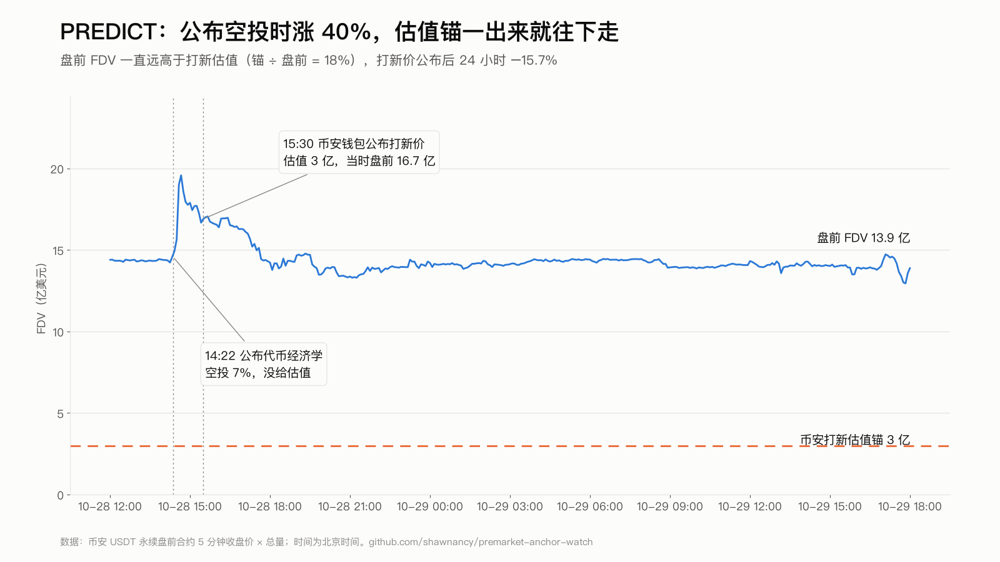
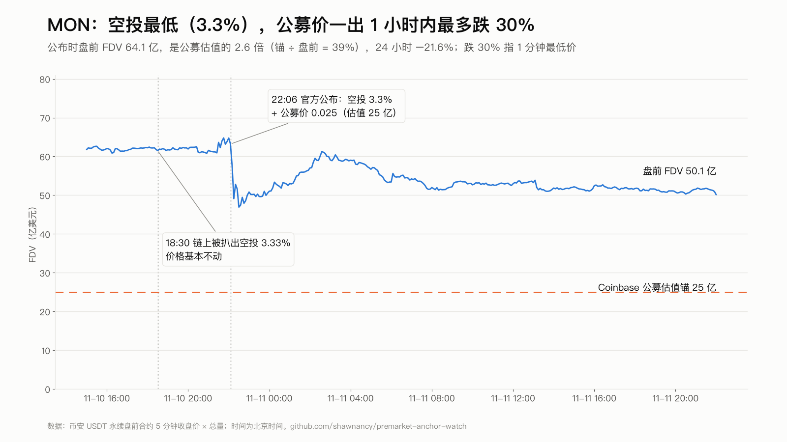
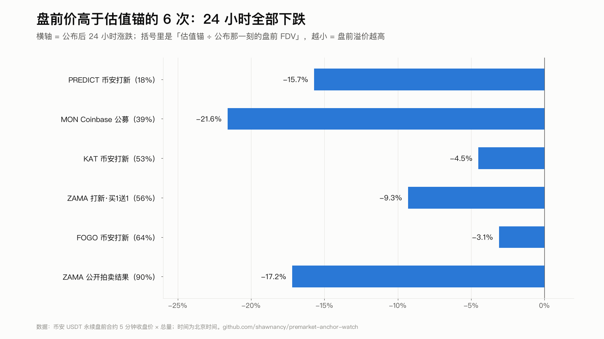

# premarket-anchor-watch

盯币安盘前合约（Pre-Market Perp）的**估值锚**和**空投比例**公布，命中规则就推送消息。只提醒，不下单。

## 为什么做这个

有人说「空投比例低于预期就立刻开多盘前合约，屡试不爽」。回测后发现这个说法不成立，真正有方向的是另一个指标：

> **估值锚 ÷ 盘前价**：项目或交易所公布的打新/公募/拍卖价，和公布那一刻盘前合约价的比值。

| 事件 | 估值锚 | 当时盘前 FDV | 锚 ÷ 盘前 | 60 分钟 | 4 小时 | 24 小时 |
|---|---|---|---|---|---|---|
| PREDICT 币安钱包打新 | 3 亿 | 16.7 亿 | 18% | +0.5% | −12.0% | −15.7% |
| MON Coinbase 公募 | 25 亿 | 64.1 亿 | 39% | −21.1% | −11.8% | −21.6% |
| KAT 币安钱包打新 | 0.9 亿 | 1.7 亿 | 53% | −0.4% | −0.8% | −4.5% |
| FOGO 币安钱包打新 | 3.5 亿 | 5.5 亿 | 64% | +4.9% | +0.9% | −3.1% |
| ZAMA 公开拍卖结果 | 5.5 亿 | 6.1 亿 | 90% | −8.3% | −9.4% | −17.2% |
| ZAMA 币安打新（买 1 送 1） | 实际 2.75 亿 | 4.95 亿 | 56% | −8.9% | −5.6% | −9.3% |

- 盘前价高于估值锚 → 24 小时 **6/6 下跌**（−3% 到 −22%），但跌幅和溢价不成正比
- 反向样本（锚高于盘前价）在 CEX 数据里找不到：币安钱包 9 期 Prime Sale + Coinbase 公募全是打新价低于盘前价
- 空投比例本身和涨跌对不上（MON 空投 3.3% 反而 1 小时内最多跌 30%）
- 成色：做空一侧【实测·小样本】，做多一侧【假设】

完整报告：[`report/空投比例公布盘前合约回测_20261029.docx`](report/)；表格数据：[`data/`](data/)。

## 图





## 监控做什么

每 5 分钟一轮：

1. 读币安 USDT 永续里标了 `Pre-Market` 的合约（+ `config.json` 的 `extra_symbols`）
2. 用 [twitterapi.io](https://twitterapi.io) 搜每个币上一轮以来的新推
3. 正则抽取：空投 %、打新价、估值 FDV、总量（支持从「20M tokens (2% of supply)」反推总量；识别「买 1 送 1」把成本减半）
4. 判定并推送：

| 条件 | 推送 |
|---|---|
| 锚 ÷ 盘前 < 100% | 【偏空】附历史数据 |
| 锚 ÷ 盘前 ≥ 100% | 【反向样本·仅观察】 |
| 空投 < 10% 且还没有锚 | 【仅观察】 |
| 有估值但没总量 | 【估值锚待核】 |

5. 每次推送记录当时标记价，1/4/24 小时后自动回填收益到 `events.jsonl`，样本自动积累

出声机制：X API 连续失败 6 次推「监控失明」；崩溃推一次（6 小时内不重复）；`heartbeat.txt` 记录每轮。

## 运行

```bash
python3 watch.py --selftest   # 阳性对照（8 条真实历史推文），不联网
python3 watch.py --dry        # 跑一轮但不推送、不写状态
python3 watch.py              # 正式一轮；首次运行只预热不推送
```

crontab：

```
*/5 * * * * cd /path/premarket-anchor-watch && flock -n /tmp/paw.lock python3 watch.py >> cron.log 2>&1
```

`config.json`：
- `twitterapi_key_file`：twitterapi.io key 所在文件（key 不进仓库）
- `notify_dir`：提供 `send_imessage(text)` 的 `notify.py` 所在目录（换成自己的通知函数即可）
- `known_anchor`：手动登记已公布过的估值锚，避免误报「无锚」
- `supply`：手动指定总量
- `x_daily_call_cap`：每日 X API 调用上限

## 目录

```
watch.py              监控主程序
config.json           配置
selftest_cases.json   阳性/阴性对照用例（真实推文）
report/               Word 回测报告
data/                 报告里的表（CSV）+ 原始事件/抽取数据（JSON）
research/             回测脚本（需要自备 tw.sh：调用 twitterapi.io 的包装脚本）
```

## 已知局限

- 只盯币安；Hyperliquid 盘前（很多小币只在那里有盘前）不在范围内，它的历史 K 线只在 AWS 付费存档里
- 估值锚依赖 X 上有人写出数字，太口语化的写法会漏
- 回测样本小（有锚 6 次），不构成交易建议
